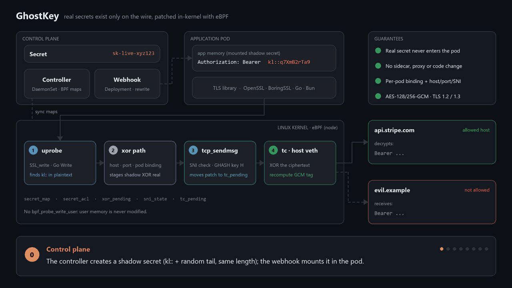
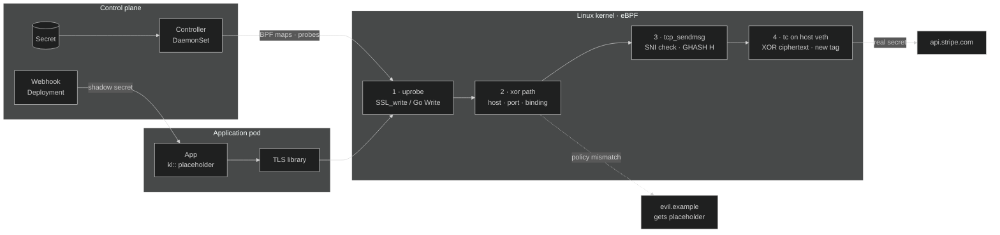

<div align="center">


# GhostKey

**Your pods hold ghosts. The real secret only exists on the wire.**

Kubernetes secret protection with eBPF: applications use same-length placeholders, and the kernel
patches the real value into the encrypted TLS record after it leaves the pod.
No sidecar, no proxy, no SDK, no code change.

[](https://github.com/roudayna/ghostkey/actions/workflows/ci.yml)
[](https://go.dev/)
[](https://kubernetes.io/)
[](https://ebpf.io/)
[](LICENSE)



</div>

---

## Why GhostKey

A Kubernetes Secret mounted in a pod is readable by everything in that pod: a compromised dependency,
a debug shell, a heap dump, a log line. GhostKey removes the secret from the pod entirely.

| | Classic Secret | GhostKey |
|---|---|---|
| What the app reads | `sk-live-xyz123` | `kl::q7XmB2rTa9` (random, same length) |
| Secret in pod memory, env, files | yes | **never** |
| Leaked value usable elsewhere | yes | no, it is a worthless placeholder |
| Sent to an unexpected host | yes | no, host / port / SNI / pod binding enforced |
| Application changes | none | none |

## Features

- **Zero application changes.** Mount a Secret or use `secretKeyRef` / `envFrom` as usual, and make HTTPS calls.
- **Secret never enters the pod.** Nothing writes to user memory (there is no `bpf_probe_write_user`). The real value is XOR-patched into the AES-GCM ciphertext and the GCM tag is recomputed in-kernel.
- **Exfiltration-resistant.** Each secret can be bound to a host, an IP and a port. The TLS SNI must match, and only the pods that reference a secret can redeem it.
- **Patched outside the pod.** The tc program runs on the host side of the pod's veth, so in-pod packet capture never sees the real ciphertext.
- **Broad runtime support.** OpenSSL, BoringSSL, Go `crypto/tls` and Bun (including single executables). That covers Python, Node.js, Go, Rust, Ruby, PHP, curl and more.
- **Kubernetes native.** One label on a Secret and one on a Namespace or Pod. A fail-closed webhook and a DaemonSet controller do the rest.

## How it works

<table>
<tr>
<td width="33%" valign="top">

**1. Label the Secret**

```yaml
apiVersion: v1
kind: Secret
metadata:
  name: api-credentials
  labels:
    ghostkey.io/enabled: "true"
  annotations:
    ghostkey.io/hosts: "api.stripe.com"
    ghostkey.io/port: "443"
stringData:
  api-key: sk-live-xyz123
```

</td>
<td width="33%" valign="top">

**2. Deploy as usual**

The webhook rewrites the pod's secret references to the shadow secret `api-credentials-ghostkey`. The app reads:

```text
kl::q7XmB2rTa9
```

Same length as the real value, and the same HPACK Huffman length, so HTTP/1.1 and HTTP/2 framing stay valid.

</td>
<td width="33%" valign="top">

**3. The kernel does the swap**

```text
app writes  → Bearer kl::q7XmB2rTa9
on the wire → AES-GCM record, patched
server sees → Bearer sk-live-xyz123
```

Any other destination receives the placeholder unchanged.

</td>
</tr>
</table>

## Architecture



| Component | Role |
|---|---|
| **Controller** (DaemonSet, `hostPID`) | Watches Secrets labeled `ghostkey.io/enabled=true` and creates their shadow `<name>-ghostkey`. Syncs real values into BPF maps, discovers container cgroups, binds pods to the secrets they reference and attaches the probes. |
| **Webhook** (Deployment) | `/mutate-pods` rewrites Secret volumes, `secretKeyRef` and `envFrom` to shadow secrets. It fails closed if a shadow is missing. `/validate-secrets` rejects secrets the data plane cannot protect. |
| **① TLS uprobes** | Hook `SSL_write` / `SSL_write_ex`, `crypto/tls.(*Conn).Write`, or a per-version offset in stripped Bun binaries. They scan the plaintext for `kl::` and only read it. |
| **② XOR path** | Checks the secret's host / IP / port policy and the per-pod binding (`secret_acl`), then stages `shadow ⊕ real` in `xor_pending`. |
| **③ `tcp_sendmsg` kprobe** | Enforces the SNI of the connection's first ClientHello and obtains the GHASH key `H` (from the library's GCM state, or `H = AES_K(0)` for BoringSSL). Moves the patch to `tc_pending`. |
| **④ tc on the host veth** | Finds the TLS record carrying the write, XOR-patches the ciphertext and recomputes the AES-GCM tag (`tc_ghash_update`). Uses TCX on Linux ≥ 6.6, clsact otherwise. |
| **Supporting probes** | `udp_recvmsg` DNS snooping (`dns_ip_map`), `connect` / `close` tracepoints (`conn_ip_map`), process lifecycle, plus an experimental virtual-IP resolver (`--host-resolution=virtual-ip`). |

### Supported runtimes

| Runtime | TLS library | Hook |
|---|---|---|
| Python, Rust, Ruby, PHP, curl | OpenSSL (`libssl.so`) | `SSL_write` / `SSL_write_ex` |
| Node.js | OpenSSL, statically linked | `SSL_write` in the main executable |
| BoringSSL-linked apps | BoringSSL | `SSL_write` |
| Bun (incl. single executables) | BoringSSL, stripped | `SSL_write` at a per-version offset |
| Go | `crypto/tls` | `crypto/tls.(*Conn).Write` |

GhostKey patches **AES-128-GCM and AES-256-GCM** records (TLS 1.2 and 1.3). ChaCha20-Poly1305, GnuTLS and Go BoringCrypto are not supported yet.

### Destination verification

A secret restricted with `ghostkey.io/hosts` is only rewritten when every check passes:

1. **DNS:** the destination IP comes from a DNS answer for that host (`dns_ip_map`, TTL enforced).
2. **Connect:** the socket was connected to that IP (`conn_ip_map`, `last_verified_fd`).
3. **SNI:** the connection's ClientHello named that exact host, so a CDN IP shared by another tenant is not enough. Connections without SNI or with ECH are refused.
4. **Binding:** the writing pod references the secret in its spec.

Refusals are logged by the controller. `controller.ebpf.sniCheck: audit` and `controller.ebpf.secretBinding: audit` let them through while logging each one, which helps you find workloads before you enforce.

## Quick start

**Requirements:** Kubernetes 1.28+, Linux kernel 5.17+ on the nodes, Helm 3.12+.

```bash
helm install ghostkey ./charts/ghostkey -n ghostkey-system --create-namespace
kubectl get pods -n ghostkey-system

# Opt a namespace in
kubectl label namespace my-app ghostkey.io/enabled=true
```

### Labels and annotations

| Key | Kind | On | Meaning |
|---|---|---|---|
| `ghostkey.io/enabled=true` | label | Secret, Namespace, Pod | Creates a shadow secret (on a Secret). Puts a namespace or pod in webhook scope. |
| `ghostkey.io/hosts=<host>` | annotation | Secret | The single hostname, IP or `*` the secret may be sent to. |
| `ghostkey.io/port=<port>[/tcp\|udp]` | annotation | Secret | Restricts the destination port. |
| `ghostkey.io/managed=true` | label | Secret | Set by GhostKey on shadow secrets. Do not set it yourself. |

Secret values must be 8 to 128 bytes long. The validating webhook explains any rejection.

### Local demo

```bash
./examples/setup-demo.sh                 # Lima VM + k3s + GhostKey + sample apps
export KUBECONFIG=/tmp/ghostkey-k3s.yaml
kubectl logs -f -l app=demo-python -n ghostkey-demo -c demo-app
./examples/destroy-demo.sh
```

## Development

```bash
make build              # bin/ghostkey
make test               # Go unit tests
make test-bpf-helpers   # userspace tests for pkg/ebpf/bpf/helpers.h
make generate-ebpf      # regenerate eBPF bindings (Linux, or Lima on macOS)
make test-linux         # tests inside the Lima VM
make docker-build       # container image
```

```text
cmd/ghostkey/      CLI: controller, webhook, secrets validate, version
pkg/controller/    Pod and Secret reconcilers, NRI plugin
pkg/ebpf/          probe attach, BPF map sync, tc attach, per-library offsets
pkg/ebpf/bpf/      eBPF C source and unit-tested pure helpers
pkg/webhook/       mutating and validating admission webhooks
pkg/secrets/       Source interface, shadow generator, k8s and YAML sources
charts/ghostkey/   Helm chart
examples/          demo apps for each runtime (used by e2e)
tools/             TLS struct offset discovery per library version
```

The animation above is generated by [`docs/assets/make_architecture_gif.py`](docs/assets/make_architecture_gif.py) (Pillow).

## License

GhostKey is maintained by **Roudayna Kouka** and released under the [GNU AGPL v3](LICENSE).
It is a modified version of the AGPL-licensed Kloak project. See [NOTICE](NOTICE).
